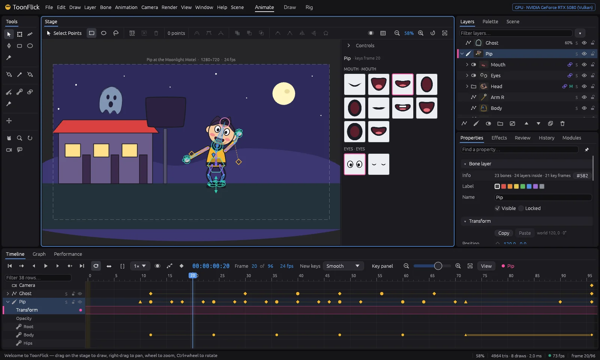
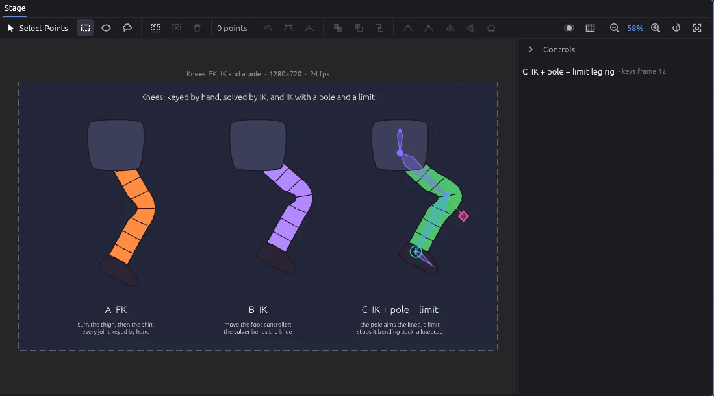
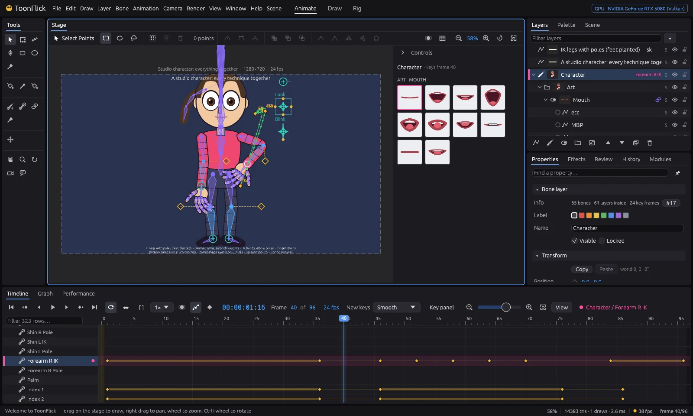
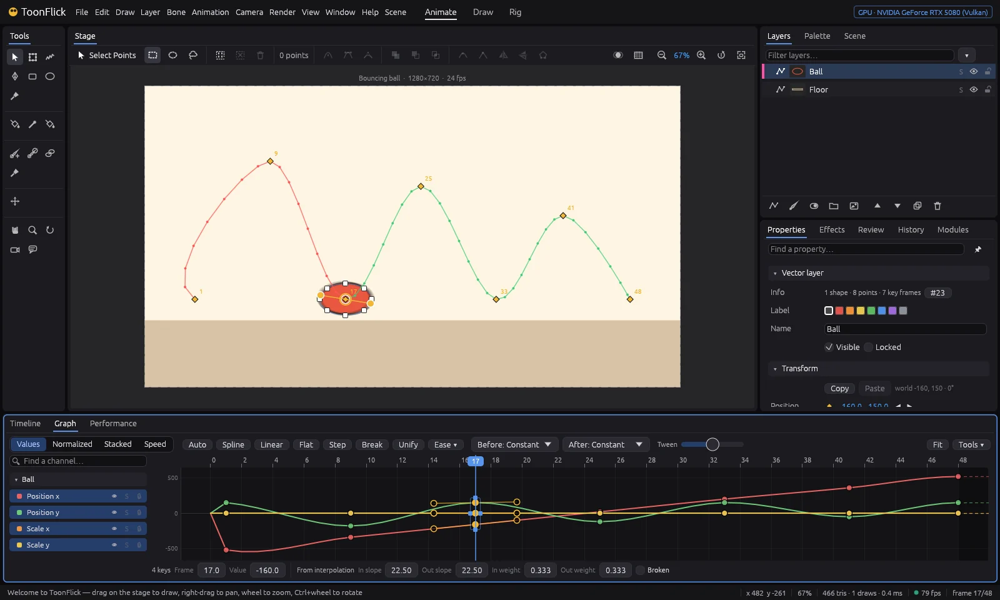
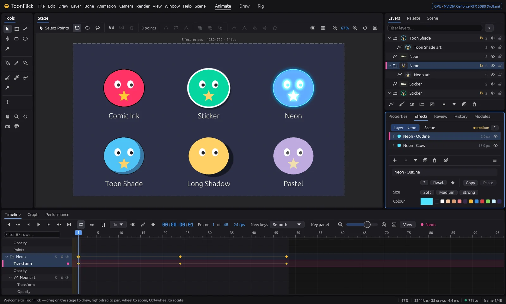

# ToonFlick

**A 2D cartoon animation studio** — vector drawing, bone rigs with IK, controllers and limits,
switch layers and lip-sync, a timeline with a graph editor and motion paths, effects, light and
GPU rendering. For rubber-hose limbs, mouth charts and punchy easing.

This repository holds the **ready-to-run builds** of ToonFlick for Windows, macOS and Linux, the
notes of every version and the place to report bugs and ask for features. The source code is
developed in a separate repository.

[Website](https://toonflick.com) · [Tutorials](https://toonflick.com/tutorials.html) ·
[Roadmap](https://toonflick.com/roadmap.html) · [Changelog](CHANGELOG.md) ·
[**Download the latest version**](https://github.com/ToonFlick-Team/toonflick-releases/releases/latest)



> **Early version.** ToonFlick is in active development (0.x): things change from version to
> version and some parts are still rough. Keep copies of projects that matter, and please tell us
> what breaks.

## Download

Every version is on the [Releases](https://github.com/ToonFlick-Team/toonflick-releases/releases)
page. Pick the file for your system (`<version>` is e.g. `0.13.1`):

| System | File |
|---|---|
| Windows 10 / 11, Intel or AMD (x64) | `ToonFlick-<version>-windows-x64.zip` |
| Windows 11 on ARM | `ToonFlick-<version>-windows-arm64.zip` |
| macOS, Apple silicon (M1 and later) | `ToonFlick-<version>-macos-arm64.dmg` |
| macOS, Intel | `ToonFlick-<version>-macos-x64.dmg` |
| Linux x64, any distribution | `ToonFlick-<version>-linux-x64.AppImage` |
| Debian, Ubuntu, Mint… (x64) | `toonflick_<version>_amd64.deb` |
| Linux x64, plain archive | `ToonFlick-<version>-linux-x64.tar.gz` |

`SHA256SUMS.txt` in each release lists the checksums of all its files.

## Install and run

**Windows** — unzip the folder anywhere and run `bogo.exe`. The builds aren't code-signed yet, so
SmartScreen may say *Windows protected your PC*: choose **More info ▸ Run anyway**.

**macOS** — open the `.dmg` and drag **ToonFlick** to Applications. The app isn't notarized yet:
the first time, **right-click ToonFlick ▸ Open ▸ Open** (or allow it in System Settings ▸ Privacy &
Security). If macOS says the app is damaged, run once in Terminal:

```sh
xattr -dr com.apple.quarantine /Applications/ToonFlick.app
```

**Linux** — the AppImage runs on most distributions:

```sh
chmod +x ToonFlick-*-linux-x64.AppImage
./ToonFlick-*-linux-x64.AppImage
```

On Debian and Ubuntu the `.deb` adds ToonFlick to the applications menu (`toonflick` in a
terminal):

```sh
sudo apt install ./toonflick_*_amd64.deb
```

The `.tar.gz` holds the same programs to run from a folder (`./bogo`). ToonFlick runs on X11 and
Wayland.

**Checking a download** (optional) — compare its checksum with `SHA256SUMS.txt`:

```sh
sha256sum -c SHA256SUMS.txt --ignore-missing        # Linux
shasum -a 256 ToonFlick-*.dmg                         # macOS
certutil -hashfile ToonFlick-0.13.1-windows-x64.zip SHA256   # Windows
```

## What you need

- A graphics card with **Vulkan, Metal or DirectX 12** — practically any computer from the last
  ten years. ToonFlick draws the stage on the GPU.
- Windows 10 or 11, macOS 11 or newer, or a Linux with glibc 2.35 or newer (Ubuntu 22.04, Debian
  12, Fedora 36 and later).
- A mouse, or a pen tablet for pressure-sensitive lines.

## What's inside

| Area | What you get |
|---|---|
| Drawing | Freehand with pen pressure, pen and point tools, shapes, fill and gradients, brushes (ink, pencil, marker, chalk, boiling lines), palette swatches linked to shapes |
| Rigging | Bones with FK and IK, controllers, poles, angle limits, binding drawings and points to bones, corrective shapes, joysticks and dials, switch layers |
| Animation | Frame 0 as the setup pose, keys everywhere, easing presets, timeline with retiming, **graph editor**, **motion paths** you can bend on the stage, onion skin |
| Sound | WAV soundtrack in sync, scrubbing, waveform, Papagayo import, automatic lip-sync |
| Look | Effects, light, physics and particles |
| Output | GPU rendering to PNG, PNG sequences, GIF and video (MP4, ProRes with alpha, WebM — with [FFmpeg](https://ffmpeg.org) installed) |
| Agents | Every command is an MCP tool: AI agents can drive ToonFlick (`bogo-mcp`, `bogo-cli` come with it) |

| | |
|---|---|
|  |  |
|  |  |

New to it? The [tutorials](https://toonflick.com/tutorials.html) go step by step: a bouncing ball,
the graph editor and motion paths, then rigging an arm with bones, controllers, poles and limits.

## Bugs and ideas

- **Something broke?** [Report a bug](https://github.com/ToonFlick-Team/toonflick-releases/issues/new?template=bug_report.yml)
  — the version (Help ▸ About), your system and the steps help most; a project file or a screen
  recording even more.
- **Missing something?** [Ask for a feature](https://github.com/ToonFlick-Team/toonflick-releases/issues/new?template=feature_request.yml).
  Give a 👍 to the requests you'd like too — that's how we see what matters most.

## Versions

ToonFlick goes up in larger steps (0.13, 0.14…) about twice a month; fixes come as 0.13.1, 0.13.2…
What changed in each one: [CHANGELOG.md](CHANGELOG.md) and the notes of each
[release](https://github.com/ToonFlick-Team/toonflick-releases/releases).
